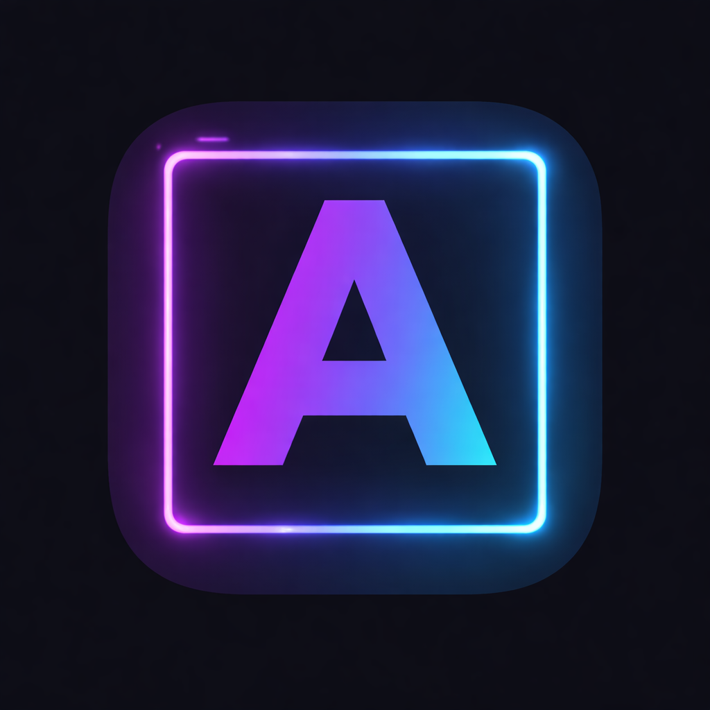
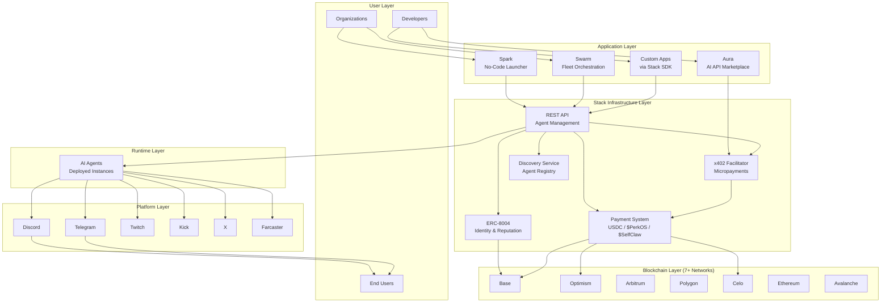
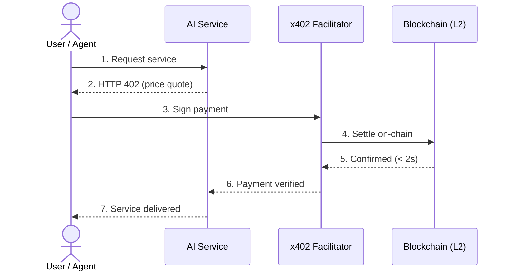

# PerkOS

<p align="center">
  
</p>

> **Infrastructure for the Agentic Economy**

Deploy, manage, and scale AI agents across your organization with built-in micropayments, on-chain identity, and fleet orchestration.

[](https://perkos.xyz)
[](https://x.com/perk_os)
[](https://farcaster.xyz/perkos)
[](LICENSE)

---

## Overview

**PerkOS** is the complete infrastructure platform for the agentic economy. Four products work together to give organizations everything they need to launch, manage, monetize, and orchestrate AI agents at scale -- powered by the [x402 protocol](https://www.x402.org/) championed by Coinbase and the x402 Foundation.

<p align="center">
  
</p>

### Why PerkOS

- **$0.0001** minimum transaction -- sub-cent micropayments on L2
- **< 2 second** settlement -- instant, zero chargebacks
- **7+ networks** -- Base, Optimism, Arbitrum, Polygon, Celo, Ethereum, Avalanche
- **6 platforms** -- Discord, Telegram, Twitch, Kick, X, Farcaster
- **Open source** -- MIT licensed, 10+ npm packages, full TypeScript

---

## Products

### Stack -- Core Infrastructure


**Status**: Live | **Website**: [stack.perkos.xyz](https://stack.perkos.xyz) | **GitHub**: [PerkOS-xyz/Stack](https://github.com/PerkOS-xyz/Stack)

The backbone of PerkOS. x402 payment facilitator, agent registry, multi-chain settlement, and the infrastructure layer that powers every other product.

**Core Services**:

- **x402 Facilitator** -- HTTP 402 payment verification and processing
- **Agent Registry & Discovery** -- Public agent directory with search and filtering
- **Multi-chain Settlement** -- 7+ networks with near-zero L2 fees
- **ERC-8004 Identity** -- On-chain agent identity and reputation scoring
- **Real-time Analytics** -- Usage metrics, transaction history, WebSocket logs

```bash
npm install @perkos/service-x402
```

---

### Spark -- No-Code Agent Launcher


**Status**: Building | **Website**: [spark.perkos.xyz](https://spark.perkos.xyz) | **GitHub**: [PerkOS-xyz/Spark](https://github.com/PerkOS-xyz/Spark)

Deploy intelligent AI agents with personality, knowledge bases, and built-in monetization across Discord, Telegram, Twitch, Kick, X, and Farcaster. No code required.

**Key Features**:

- Visual character editor with AI personality configuration
- Multi-platform deployment (Discord, Telegram, Twitch, Kick, X, Farcaster)
- Built-in x402 monetization and knowledge base training
- Real-time engagement analytics and monitoring

**Target Users**: Community managers, Web3 founders, content creators

---

### Aura -- AI API Marketplace



**Status**: Live | **Website**: [aura.perkos.xyz](https://aura.perkos.xyz) | **GitHub**: [PerkOS-xyz/PerkOS-Aura](https://github.com/PerkOS-xyz/PerkOS-Aura)

20 production-ready AI endpoints for vision, NLP, and developer tools. Pay per API call with instant micropayments via x402 -- no subscriptions, no API keys, no minimums.

**Key Features**:

- 20 AI endpoints (vision, NLP, developer tools)
- Pay-per-call micropayments from $0.0001/call
- Wallet-based authentication (no API keys)
- x402-native integration

---

### Swarm -- Fleet Orchestration


**Status**: Building | **Website**: [swarm.perkos.xyz](https://swarm.perkos.xyz) | **GitHub**: [PerkOS-xyz/Swarm](https://github.com/PerkOS-xyz/Swarm)

AI fleet orchestration for organizations. Coordinate hundreds of agents with real-time communication, task boards, resource allocation, and monitoring at scale.

**Key Features**:

- Fleet orchestration dashboard
- Real-time agent communication hub (WebSocket)
- Task boards and resource allocation
- Multi-agent coordination and monitoring

**Target Users**: Enterprise teams, AI operations managers

---

## System Architecture



### x402 Payment Flow



---

## Quick Start

### For Organizations (Spark)

1. Visit [spark.perkos.xyz](https://spark.perkos.xyz)
2. Connect your wallet
3. Configure your agent's personality and knowledge base
4. Select platforms (Discord, Telegram, Twitch, Kick, X, Farcaster)
5. Deploy -- your agent is live

**Time to deployment**: ~5 minutes | **Technical skills**: None

### For Developers (Stack SDK)

```bash
# Install the x402 service package
npm install @perkos/service-x402
```

```typescript
import { Stack } from "@perkos/stack-sdk";
const stack = new Stack({ apiKey: "your-api-key" });

// Create and deploy an agent
const agent = await stack.agents.create({
  name: "My Agent",
  character: {
    bio: "A helpful AI assistant",
    traits: ["helpful", "friendly", "knowledgeable"],
  },
});

await stack.agents.deploy(agent.id);
```

**Documentation**: [stack.perkos.xyz/docs](https://stack.perkos.xyz/docs) | **API Reference**: [stack.perkos.xyz/api](https://stack.perkos.xyz/api)

### For AI Vendors (Aura)

Visit [aura.perkos.xyz](https://aura.perkos.xyz) to access 20 AI endpoints. No API keys -- pay per call with your wallet via x402.

---

## Pricing

All products accept **USDC**, **$PerkOS**, and **$SelfClaw** tokens.

### Spark (Credit-based)

| Plan           | Credits   | Connectors     | Price  |
| -------------- | --------- | -------------- | ------ |
| **Free**       | 1,000     | 1              | $0/mo  |
| **Starter**    | 15,000    | 2              | $9/mo  |
| **Pro**        | 75,000    | All            | $29/mo |
| **Scale**      | 300,000   | All + Priority | $99/mo |
| **Enterprise** | Unlimited | All + SLA      | Custom |

Earn 5% back in **$PerkOS** tokens on every package purchase.

### Stack (API Usage)

| Plan           | API Calls | Networks       | Price   |
| -------------- | --------- | -------------- | ------- |
| **Free**       | 1,000     | 1              | $0/mo   |
| **Starter**    | 50,000    | 3              | $5/mo   |
| **Pro**        | 500,000   | All            | $49/mo  |
| **Scale**      | 5,000,000 | All + Priority | $299/mo |
| **Enterprise** | Unlimited | All + SLA      | Custom  |

### Swarm (Fleet Management)

| Plan           | Agents    | Projects  | Members   | Price   |
| -------------- | --------- | --------- | --------- | ------- |
| **Free**       | 3         | 1         | 2         | $0/mo   |
| **Starter**    | 10        | 3         | 5         | $19/mo  |
| **Pro**        | 50        | 10        | 15        | $49/mo  |
| **Scale**      | 200       | Unlimited | 50        | $199/mo |
| **Enterprise** | Unlimited | Unlimited | Unlimited | Custom  |

### Aura

Pay-per-call micropayments from **$0.0001/call** via x402. No subscriptions.

---

## Tokens

### $PerkOS

Utility token for the PerkOS ecosystem. Used for payments, governance, and earn-back rewards.

| Network  | Contract Address                                                                                                                       |
| -------- | -------------------------------------------------------------------------------------------------------------------------------------- |
| **Base** | [`0xF714E60f85497D70508F7E356b5DB80e64539BA3`](https://app.uniswap.org/explore/tokens/base/0xf714e60f85497d70508f7e356b5db80e64539ba3) |
| **Celo** | [`0xb7Ba43fBD4F2E85FCE929f7d4DFE3905Ae846A46`](https://app.uniswap.org/explore/tokens/celo/0xb7ba43fbd4f2e85fce929f7d4dfe3905ae846a46) |

### $SelfClaw

Community token accepted across all PerkOS products.

| Network  | Contract Address                                                                                                                       |
| -------- | -------------------------------------------------------------------------------------------------------------------------------------- |
| **Base** | [`0x9ae5f51d81ff510bf961218f833f79d57bfbab07`](https://app.uniswap.org/explore/tokens/base/0x9ae5f51d81ff510bf961218f833f79d57bfbab07) |
| **Celo** | [`0xCD88f99Adf75A9110c0bcd22695A32A20eC54ECb`](https://app.uniswap.org/explore/tokens/celo/0xcd88f99adf75a9110c0bcd22695a32a20ec54ecb) |

---

## Technology Stack

| Layer              | Technologies                                                 |
| ------------------ | ------------------------------------------------------------ |
| **Protocol**       | x402 (HTTP 402), ERC-8004 (on-chain identity)                |
| **Blockchain**     | Base, Optimism, Arbitrum, Polygon, Celo, Ethereum, Avalanche |
| **Payments**       | USDC, $PerkOS, $SelfClaw                                     |
| **Platforms**      | Discord, Telegram, Twitch, Kick, X, Farcaster                |
| **Frontend**       | Next.js 15, React, TypeScript, Tailwind CSS 4                |
| **Backend**        | Node.js, TypeScript                                          |
| **Infrastructure** | Multi-chain settlement, WebSocket real-time logs             |

---

## Repository Structure

```
PerkOS/
├── Stack/              # Core infrastructure middleware (submodule)
├── Spark/              # No-code agent launcher (submodule)
├── PerkOS/             # Landing site (Next.js)
│   ├── app/            # App Router pages & API routes
│   ├── components/     # React components (UI, forms, header)
│   ├── lib/            # Utilities
│   └── public/         # Static assets
├── Media/              # Brand assets and logos
├── Docs/               # Marketing docs, pitch, product specs
│   ├── MARKETING.md
│   ├── PITCH.md
│   ├── PRODUCT.md
│   └── PERKOS-MARKETING-GUIDE.md
├── LICENSE             # MIT License
└── README.md           # This file
```

> **Note**: Aura and Swarm have their own repositories under the [PerkOS-xyz](https://github.com/PerkOS-xyz) GitHub organization.

---

## Key Differentiators

|                   | PerkOS                        | Traditional Solutions  |
| ----------------- | ----------------------------- | ---------------------- |
| AI-Powered Agents | Full AI with personality      | Rules-based bots       |
| Payments          | x402 micropayments (sub-cent) | Subscription / invoice |
| Settlement        | < 2 seconds on L2             | Days to weeks          |
| Identity          | On-chain (ERC-8004)           | Centralized / none     |
| Multi-chain       | 7+ networks                   | Single chain or none   |
| Multi-platform    | 6 platforms                   | 1-2 platforms          |
| No-code Option    | Spark                         | Usually code-only      |
| Fleet Management  | Swarm                         | DIY orchestration      |
| Open Source       | MIT licensed                  | Proprietary            |

---

## Roadmap

### Completed

- Stack core infrastructure (x402 facilitator, agent registry, multi-chain settlement)
- Aura AI API marketplace (20 endpoints, live)
- Landing site with waitlist capture
- x402 protocol integration
- 7+ network support
- $PerkOS and $SelfClaw token deployment on Base and Celo

### In Progress (Q1 2026)

- Spark MVP (no-code agent launcher)
- Swarm fleet orchestration platform
- ERC-8004 identity system
- Enhanced analytics dashboard

### Upcoming (Q2-Q3 2026)

- Agent marketplace with reputation scoring
- Advanced fleet orchestration features
- Enterprise white-label solutions
- Developer grants program
- Mobile companion app

---

## Contributing

PerkOS is open source and we welcome contributions. See individual product repositories for contribution guidelines:

- [Stack](https://github.com/PerkOS-xyz/Stack)
- [Spark](https://github.com/PerkOS-xyz/Spark)
- [Aura](https://github.com/PerkOS-xyz/PerkOS-Aura)
- [Swarm](https://github.com/PerkOS-xyz/Swarm)

---

## Community & Support

| Channel     | Link                                            |
| ----------- | ----------------------------------------------- |
| Website     | [perkos.xyz](https://perkos.xyz)                |
| X (Twitter) | [@perk_os](https://x.com/perk_os)               |
| Farcaster   | [perkos](https://farcaster.xyz/perkos)          |
| GitHub      | [PerkOS-xyz](https://github.com/PerkOS-xyz)     |
| Email       | [contact@perkos.xyz](mailto:contact@perkos.xyz) |
| npm         | [@perkos](https://www.npmjs.com/org/perkos)     |

---

## License

MIT License. See [LICENSE](LICENSE) for details.

---

<p align="center">
  <strong>PerkOS</strong><br>
  <em>Infrastructure for the Agentic Economy</em><br><br>
  Built on <a href="https://www.x402.org/">x402</a>, championed by Coinbase.
</p>
